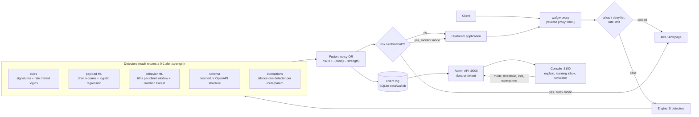

# Architecture

## Request flow

Coraza + OWASP CRS (`waf/`) is the industry baseline used for the evaluation; it is not chained into
the gateway yet.

## What each detector catches

| Threat | rules | Coraza + CRS | payload ML | behavior ML | schema |
|---|---|---|---|---|---|
| SQL injection (plain, case/comment tricks) | yes | yes | yes | - | partly (odd characters) |
| SQL injection (double-encoded, novel forms) | partly | yes | yes (28/30 novel) | - | partly |
| XSS | yes (49.6% of CSIC XSS) | yes | yes | - | partly |
| Path traversal | yes (misses some encodings) | yes | yes | - | partly |
| Command injection | little | yes | yes (trained on it) | - | partly |
| Mass assignment (`role`, `is_admin`) | - | - | yes on the demo API (learned key) | - | **yes** (privileged / unknown field, also from OpenAPI) |
| Unknown / renamed parameters, odd paths (CSIC "structural") | - | - | - | - | **yes** (80.5% of them) |
| BOLA / IDOR (walking order ids) | - | - | - | **yes** (50% at a 5% alert budget) | - |
| Brute force / credential stuffing | **yes** (rate + failed-login rules, 92%) | - | - | partly (13%) | - |
| Known scanner user agents | yes (small weight) | yes | never a feature | never a feature | - |
| Response-side leaks (SQL errors, stack traces) | - | not evaluated | - | - | - |

Numbers are from the README (demo dataset, held-out CSIC 2010, novel-payload set). Read the caveats there:
the demo dataset is synthetic, CSIC is one synthetic shop, and the novel set is small.

## Where things live

| Part | Path |
|---|---|
| Detectors and fusion | `detection/` (`rules.py`, `ml_payload.py`, `ml_behavior.py`, `schema.py`, `fusion.py`) |
| Real-data loaders, hard negatives | `detection/external_data.py`, `detection/benign_text.py`, `detection/harmless_set.py` |
| Gateway (proxy, engine, store, admin API) | `wafgw/` (contract in `wafgw/README.md`) |
| Console | `dashboard/` |
| Demo API + traffic generator | `target_api/`, `traffic/` |
| Coraza + CRS baseline | `waf/` |
